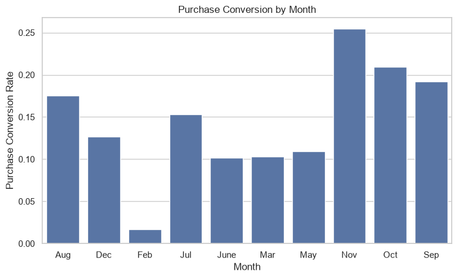
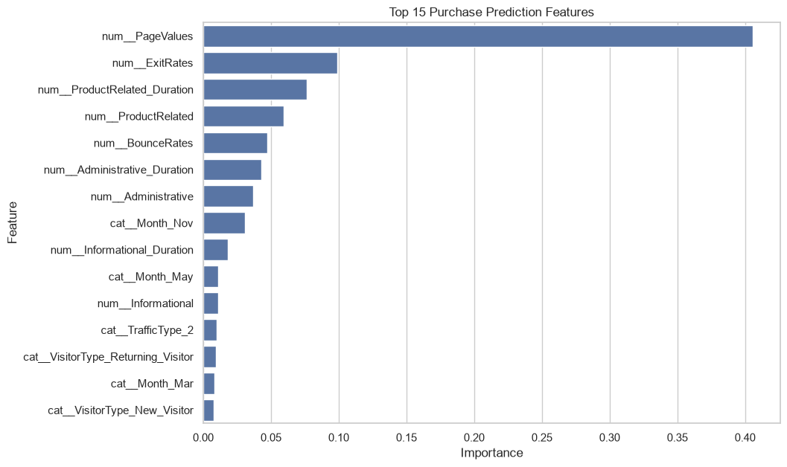
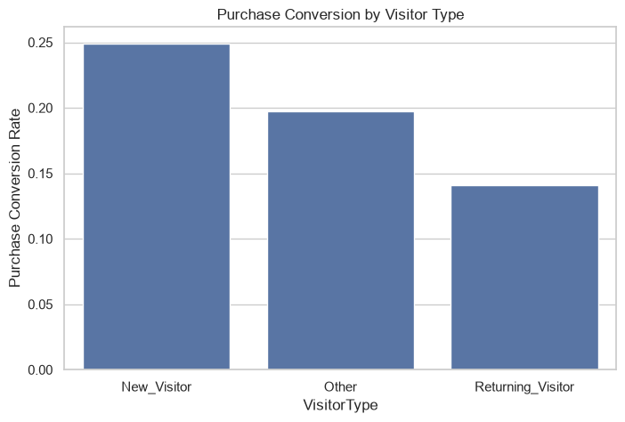
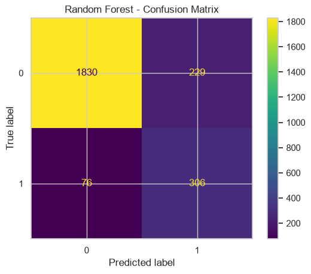

# Market Research & Consumer Behaviour Analysis

## Project Overview
This project analyses online shopping behaviour to identify factors associated with customer purchases and develop machine learning models to predict purchase intention.

## Dataset
- Source: UCI Machine Learning Repository
- Dataset: Online Shoppers Purchasing Intention
- Original records: 12,330
- Records after duplicate removal: 12,205

## Tools & Technologies
Python, Pandas, NumPy, Matplotlib, Seaborn, SciPy, Scikit-learn

## Project Workflow
1. Data collection and cleaning
2. Exploratory data analysis
3. Customer behaviour analysis
4. Statistical hypothesis testing
5. Machine learning model development
6. Model evaluation and feature importance analysis
7. Business recommendations

## Machine Learning Results

| Model | Accuracy | F1 Score | ROC-AUC |
|---|---:|---:|---:|
| Logistic Regression | 84.60% | 61.79% | 90.97% |
| Random Forest | 87.51% | 66.74% | 92.88% |

Random Forest performed better on the evaluated test split.

## Key Findings
- New visitors had a higher purchase conversion rate than returning visitors.
- November recorded the highest monthly conversion rate.
- Visitor type and weekend activity showed statistically significant associations with purchases.
- PageValues was the most influential feature in the Random Forest model.

## Important Model Limitation
PageValues contributed approximately 40.57% of the Random Forest feature importance. When excluded, ROC-AUC decreased to 78.23%. Its availability at prediction time should be investigated before considering real-time deployment.

## Business Objective
The project aims to help e-commerce businesses understand customer behaviour, identify purchase-related patterns and make more informed marketing and website optimisation decisions.

## Project Status
Completed: Initial end-to-end analysis and model evaluation.
## Key Visual Findings

### 1. Monthly Conversion Trends (November Spike)

### 2. Feature Importance (Impact of PageValues)

### 3. Visitor Type Conversion

### 4. Random Forest Confusion Matrix
